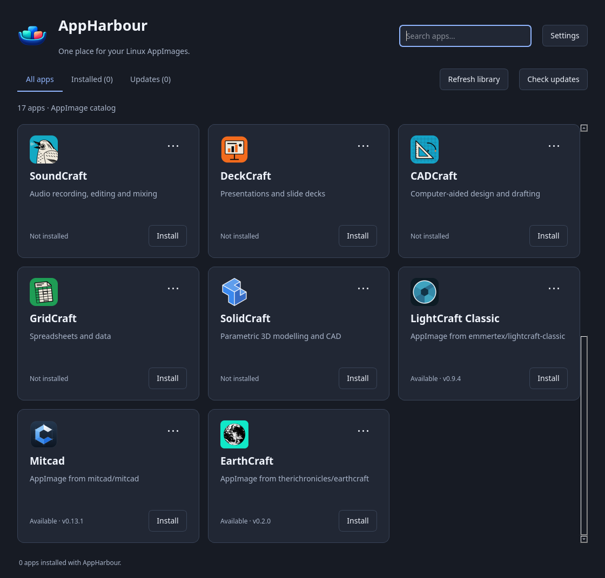

# AppHarbour


A Linux AppImage installer, updater and launcher, written in Python with PySide6.
Manage the 13 ArtCraft applications, SolidCraft and supported projects from other public
GitHub repositories in one place.



Example library with [UltiMaker Cura](https://github.com/Ultimaker/Cura),
[LightCraft Classic](https://github.com/emmertex/lightcraft-classic) and
[Mitcad](https://github.com/mitcad/Mitcad) added from GitHub with their repository icons.
Versions shown are illustrative.

## Features

- Install and launch applications from a searchable card library.
- Check installed apps for updates in the background and roll back to the previous version.
- Verify downloads against published SHA-256 checksums before installation.
- Add supported GitHub repositories directly from the library.
- Choose stable releases or include previews from each card’s menu, and inspect releases in app details.
- Choose between AppImage build variants when needed, with the choice remembered for updates.
- See GitHub request limits, retry times and cached release information from the footer.
- Discover their application icons or choose a local PNG/SVG, with offline icon storage.
- Create application-menu shortcuts and access the launcher from the system tray.
- Run a single window per user: launching AppHarbour again raises the running one.

AppHarbour manages its own installations. Existing AppImages from other launchers are
left alone. **Installed (N)** and **Updates (N)** show library totals, even while searching.

## Run

The AppHarbour AppImage includes Python and Qt. Use a release AppImage, or follow the
[build instructions](docs/development.md#build-the-appimage) to create one locally.
For version 0.2.3:

```sh
chmod +x AppHarbour-0.2.3-linux-x86_64.AppImage
./AppHarbour-0.2.3-linux-x86_64.AppImage
```

Keep the file in a permanent location: AppHarbour creates a menu shortcut pointing to it.
If you move it, launch it again to repair the shortcut. A development run never repoints an
existing working shortcut. If FUSE is unavailable, add
`--appimage-extract-and-run` to the launch command.

The current package targets Linux x86_64 desktops with glibc 2.35 or newer, such as
Ubuntu 22.04 or newer. Graphics drivers and standard desktop libraries come from the system.
Applications downloaded through AppHarbour may have their own runtime requirements.

## Add an application

1. Choose **+ Add app** above the library.
2. Enter a public GitHub repository URL and an optional display name.
3. Leave **Stable releases only** selected, or opt into prereleases.
4. Choose **Inspect repository**, review the release, then **Add to library**.
5. Use **Install** on its new card.

Repositories need a supported release and an AppImage with a published checksum.
Stable releases are the default; prerelease-only projects require explicit opt-in.
AppImage filenames can use different branding and layouts; downloads are matched to your CPU.
See the [usage guide](docs/usage.md) for supported names, updates and desktop integration.

## Roadmap

See the [roadmap](docs/roadmap.md) for planned features and designs under discussion.

## Development

Requires Python 3.11 or newer and a Linux desktop.

```sh
python3 -m venv .venv
.venv/bin/python -m pip install -e '.[dev]'
.venv/bin/python -O -m appharbour
```

See [development and packaging](docs/development.md) for checks and local builds,
and [GitHub Actions](docs/builds.md) for automated builds and tag-triggered draft releases.

## Licence and credits

AppHarbour's original code is licensed under [MIT](LICENSE).

AppHarbour's interface is original to this project. Application icons belong to their
respective projects; see [ATTRIBUTION.md](ATTRIBUTION.md) for sources and licence notices.
Bundled runtime libraries have their own [licences and source links](THIRD_PARTY_NOTICES.md).
